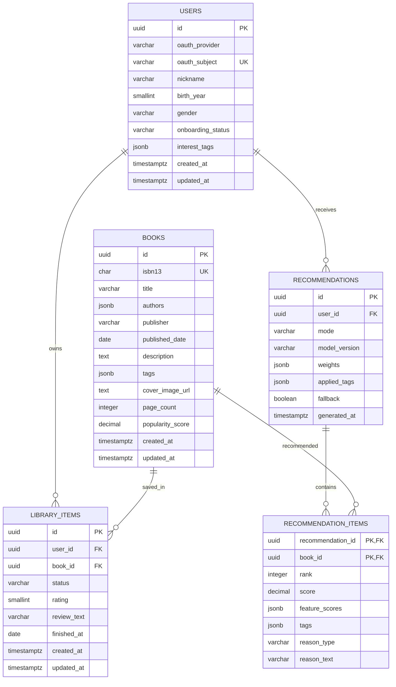

# MVP ERD

> 프로젝트: S15P21B102
>
> MVP 서비스에 실제로 필요한 핵심 도메인만 남긴 단순화 버전이다. 비회원 추천은 제공하지 않으며, 모든 추천과 개인 데이터는 로그인한 사용자 기준으로 처리한다.

## 설계 원칙

- `books`는 검색·상세·추천에 필요한 표준 도서 정보만 가진다.
- 외부 API 원본, 작품 그룹, 대출 원장, 추천용 중간 feature는 ERD에서 제외한다. 해당 데이터는 수집·배치 영역에서 관리한다.
- 초기 관심 분야는 `users.interest_tags`, 도서 태그는 `books.tags` JSONB에 저장해 별도 태그 연결 테이블을 만들지 않는다.
- 서재 상태·평점·한 줄 감상은 한 도서에 대한 사용자 기록이므로 `library_items`에 함께 저장한다.
- 추천 결과의 도서별 순위와 추천 이유는 `recommendation_items`에 저장한다.

## 관계도

## 테이블 설명

| 테이블 | 역할 | 핵심 내용 |
| --- | --- | --- |
| `users` | 회원·취향 | OAuth 계정, 프로필, 온보딩 상태, 관심 태그 |
| `books` | 도서 카탈로그 | ISBN, 서지 정보, 검색용 태그, 인기 점수 |
| `library_items` | 개인 서재 | 찜·읽는 중·완독, 평점, 감상 기록 |
| `recommendations` | 추천 결과 묶음 | 사용자별 추천 모드와 생성 시점 |
| `recommendation_items` | 추천 도서 | 순위, 점수, 추천 이유 |

## 주요 제약

- `users (oauth_provider, oauth_subject)`는 유일해야 한다.
- `books.isbn13`은 유일한 검증 ISBN-13이다.
- `library_items (user_id, book_id)`는 유일하다. 같은 책의 상태·평점·감상을 한 행에서 관리한다.
- `library_items.status`는 `WISH`, `READING`, `READ` 중 하나다.
- `library_items.rating`은 선택값이며 1~5점이다.
- `recommendations.user_id`는 필수다. 비회원 추천 스냅샷은 저장하지 않는다.
- `recommendations.mode`는 `COLD_START`, `PERSONALIZED` 중 하나다.
- `recommendation_items.rank`는 추천 묶음 안에서 유일하며 1 이상이다.

## 제외한 테이블과 이유

| 제외 대상 | 이유 |
| --- | --- |
| `book_works` | 작품-판본 그룹은 MVP 기능에 필요하지 않음 |
| `book_source_records` | 외부 원본 추적은 수집 파이프라인 영역임 |
| `book_demand_features` | 대출 원장 기반 배치 산출물임 |
| `book_content_features` | 초기에는 `books.tags`로 충분함 |
| `tags`, `book_tags`, `user_interests` | 태그를 JSONB로 단순화함 |
| `user_seed_books` | 초기 선택 도서는 `library_items`로 통합함 |
| `book_ratings` | 평점을 `library_items`로 통합함 |
| `user_events` | 분석 로그 영역이며 핵심 서비스 ERD에서 제외함 |
