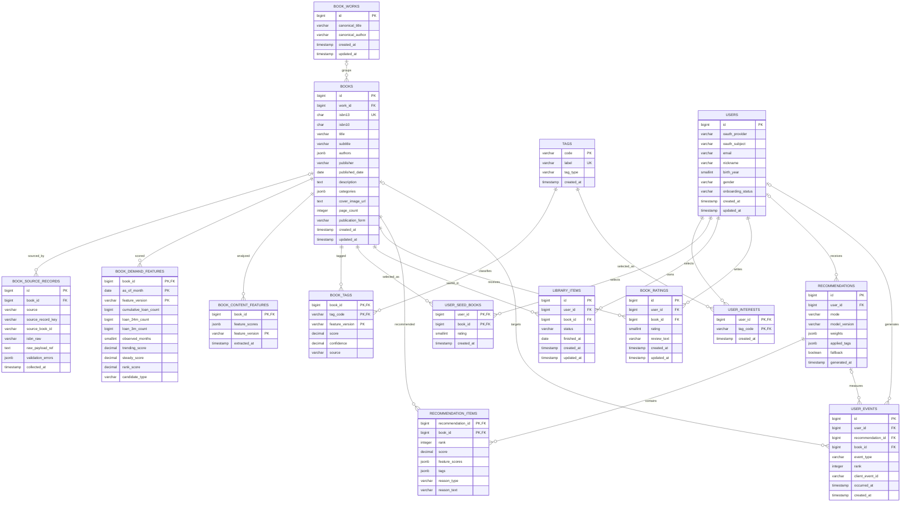

# 백엔드 ERD

> Jira: `S15P21B102-14`
>
> 이 문서는 MVP 백엔드의 PostgreSQL 운영 모델과 추천 배치/분석 모델을 함께 표현한 ERD다. 운영 DB의 내부 PK는 BIGINT 자동 증가, FK는 BIGINT, 시간 컬럼은 TIMESTAMPTZ를 사용하고 API에서는 문자열 형태의 opaque ID로 노출한다. ERDCloud import 파일에서는 호환성을 위해 일부 타입을 단순화한다.

## 1. 설계 원칙

- `books`는 제목이 아니라 **ISBN을 기준으로 한 판본(edition)** 이다. ISBN이 다르면 같은 작품이어도 별도 도서로 저장한다.
- `book_works`는 여러 판본을 묶기 위한 선택적 작품 그룹이다. 제목·저자 유사도만으로 자동 병합하지 않는다.
- `books`에는 서비스가 검색·상세·추천에 실제 사용하는 정제 값만 둔다. 배열·구조화 값은 PostgreSQL `JSONB`로 저장한다.
- 카탈로그 L0는 국중과 정보나루의 ISBN13 합집합으로 만들고, 미등재 ISBN은 카카오 온디맨드 등록으로 보강한다. 어떤 출처에서 들어왔는지는 `book_source_records`로 추적한다.
- 대출 원장은 대용량 배치/분석 저장소에서 집계하고, 서비스 DB에는 추천에 필요한 도서 단위 파생 결과만 둔다.
- 좋아요는 별도 테이블 없이 `library_items.status = WISH`로 처리한다.
- 추천 L1 후보는 누적 대출로 수요 99%를 유지하는 임계와 신간 트랙의 합집합으로 만든다. 누적 대출은 랭킹 주신호로 사용하지 않는다.
- 해시태그는 `tags`·`book_tags`에서 관리해 검색·추천·사용자 관심 분야가 같은 코드 체계를 사용한다. 태그 기반 `taste`를 포함한 최종 점수는 feature 가중치로 계산한다.
- 추천 결과 본문은 `recommendations`, 추천 도서별 순위·점수·태그·이유는 `recommendation_items`로 분리한다.

## 2. 관계도

## 3. 테이블별 최소 칼럼과 제약

### `book_works`

작품 그룹의 표시 정보만 저장한다. 판본 정보는 `books`에 둔다.

| 칼럼 | 타입 | 필수 | 설명 |
| --- | --- | --- | --- |
| `id` | BIGINT | O | 작품 그룹 식별자 |
| `canonical_title` | VARCHAR | O | 대표 작품명 |
| `canonical_author` | VARCHAR |  | 대표 저자명 |
| `created_at`, `updated_at` | TIMESTAMP | O | 변경 추적 |

### `books`

검색, 상세, 추천에 필요한 정제 도서 정보만 저장한다. `authors`, `categories`는 PostgreSQL `JSONB` 문자열 배열로 저장한다. 추천 후보 여부와 수요 점수는 `book_demand_features`에서 관리하므로 `books`에 중복 저장하지 않는다.

| 칼럼 | 타입 | 필수 | 설명 |
| --- | --- | --- | --- |
| `id` | BIGINT | O | 내부 도서 식별자 |
| `work_id` | BIGINT |  | `book_works.id`; 작품 그룹 미확정이면 NULL |
| `isbn13` | CHAR(13) | O | 하이픈 없는 검증된 ISBN-13, UNIQUE |
| `isbn10` | CHAR(10) |  | 보조 ISBN, 마지막 `X` 허용 |
| `title` | VARCHAR | O | 제목 |
| `subtitle` | VARCHAR |  | 부제 |
| `authors` | JSONB | O | 정제된 저자명 문자열 배열 |
| `publisher` | VARCHAR |  | 출판사 |
| `published_date` | DATE |  | 확정된 출간일 |
| `description` | TEXT |  | 책소개·요약 |
| `categories` | JSONB | O | 카테고리 문자열 배열. 없으면 빈 배열 |
| `cover_image_url` | TEXT |  | 선택된 표지 URL |
| `page_count` | INTEGER |  | 검증된 쪽수 |
| `publication_form` | VARCHAR |  | 종이책·전자책 등 |
| `created_at`, `updated_at` | TIMESTAMP | O | 변경 추적 |

`keywords`, `language`, `quality`, `page_raw`, `series_title`, `volume`, 누적 대출량, 도서관별 보유량은 초기 `books`에서 제외한다. 필요해질 때 별도 마이그레이션 또는 배치 산출물로 추가하고, 출처별 원본 값은 `book_source_records`에서 보존한다.

### `book_source_records`

외부 API별 원본 추적과 정제 실패 확인에 필요한 최소 칼럼이다.

| 칼럼 | 타입 | 필수 | 설명 |
| --- | --- | --- | --- |
| `id` | BIGINT | O | 원본 레코드 식별자 |
| `book_id` | BIGINT |  | canonical 도서로 확정되기 전에는 NULL |
| `source` | VARCHAR | O | `NATIONAL_LIBRARY`, `DATA4LIBRARY`, `YES24`, `ALADIN`, `KAKAO` 등 |
| `source_record_key` | VARCHAR | O | 출처와 조합해 중복 수집을 막는 안정 키. source ID 또는 정규화 ISBN |
| `source_book_id` | VARCHAR |  | 출처별 상품·volume ID |
| `isbn_raw` | VARCHAR |  | 정규화 전 ISBN |
| `raw_payload_ref` | TEXT | O | Git 외부 원본 파일 또는 오브젝트 저장소 참조 |
| `validation_errors` | JSONB | O | 검증 실패 사유 배열. 없으면 빈 배열 |
| `collected_at` | TIMESTAMP | O | 수집 시각 |

원본 JSON 자체를 DB에 넣는 것은 MVP 범위에서 제외한다. `raw_payload_ref`가 가리키는 원본 보관 정책은 수집 파이프라인에서 정한다.

국중·정보나루 원본에 연결된 레코드는 L0 카탈로그 진입 후보가 된다. 카카오 레코드는 검색 시 ISBN이 L0에 없을 때 온디맨드로 등록할 수 있으며, 모든 경우 ISBN13 정규화와 중복 검사를 먼저 수행한다.

### `book_demand_features`

외부 대출 원장을 월별로 집계해 저장한 도서 단위 파생 결과다. 원장 전체를 API 요청마다 재집계하지 않기 위해 서비스가 조회하는 저장 영역에 둔다.

| 칼럼 | 타입 | 필수 | 설명 |
| --- | --- | --- | --- |
| `book_id` | BIGINT | O | `books.id` 외래키 |
| `as_of_month` | DATE | O | 해당 월 1일로 정규화한 산출 기준일 |
| `feature_version` | VARCHAR | O | 후보·랭킹 산출 버전 |
| `cumulative_loan_count` | BIGINT | O | L1 임계·prior용 누적 대출량 |
| `loan_24m_count` | BIGINT | O | 최신과 24개월 전 차분 |
| `loan_3m_count` | BIGINT | O | 최신과 3개월 전 차분 |
| `observed_months` | SMALLINT | O | 실제 대출 원장이 관측된 개월 수. 24개월 미만이면 감쇠 |
| `trending_score` | DECIMAL | O | `loan_3m_count`를 정규화한 0~100 점수 |
| `steady_score` | DECIMAL | O | `loan_24m_count`를 정규화한 0~100 점수 |
| `rank_score` | DECIMAL | O | `loan_24m_count + 4 * loan_3m_count` |
| `candidate_type` | VARCHAR | O | `DEMAND`, `NEW`, `DEMAND_AND_NEW` |
`book_demand_features`는 대용량 분석 영역 또는 PostgreSQL의 파생 테이블로 저장할 수 있으며, 서비스 DB에서는 `book_id`를 외래키로 사용한다. 배치 입력의 ISBN13 JOIN은 수집 영역에서 수행한다. 원본 대출량을 그대로 가중합에 넣지 않고 배치에서 0~100 범위로 정규화한 `trending_score`와 `steady_score`를 함께 만든다. `observed_months`가 24개월보다 작으면 `steady_score`와 `rank_score`에 감쇠를 적용한다. L1 후보는 `cumulative_loan_count`의 절대값을 고정하지 않고 전체 대출 수요의 99%를 유지하는 임계로 결정한다. 현재 실측값 `72+`는 기준 데이터셋의 결과일 뿐 코드에 영구 상수로 박지 않는다. `NEW`는 국중 2025년 이후 도서 중 대출 데이터에 아직 유입되지 않은 도서로 구성한다.

### `book_content_features`

책소개·목차·카테고리 등 콘텐츠에서 추출한 책 단위 feature를 저장한다. 각 feature는 `score`(0~100)와 `confidence`(0~1)를 함께 가진 JSON 객체로 관리한다. 예를 들어 `time_regression`, `fantasy`, `realistic`, `light_tone`, `emotional_intensity`, `difficulty` 등을 저장할 수 있다.

| 칼럼 | 타입 | 필수 | 설명 |
| --- | --- | --- | --- |
| `book_id` | BIGINT | O | `books.id` 외래키 |
| `feature_scores` | JSONB | O | 콘텐츠 feature별 점수·신뢰도 |
| `feature_version` | VARCHAR | O | 추출 규칙·모델 버전 |
| `extracted_at` | TIMESTAMP | O | feature 추출 시각 |

짧거나 불완전한 책소개에서 판단할 수 없는 feature는 0점이 아니라 `score = null`과 낮은 confidence로 저장한다. feature는 사용자 요청마다 새로 추출하지 않고, 책소개가 변경되거나 추출 버전이 바뀔 때 배치로 갱신한다.

책의 카테고리·저자·텍스트 정보는 `books`와 검색 인덱스에 저장하고, 통제된 태그는 `book_tags`에서 Elasticsearch의 `tag_code`·`tag_label`로 색인한다. `taste`, `coLoan`, `newField`처럼 사용자별로 달라지는 feature 점수는 추천 계산 시 산출한다. 계산된 후보별 feature 점수와 화면용 태그는 추천 스냅샷의 `recommendation_items`에 저장해 당시 가중치와 추천 근거를 재현할 수 있게 한다.

### `tags`

검색·추천·사용자 관심 분야에서 공통으로 사용하는 통제 태그 사전이다.

| 칼럼 | 타입 | 필수 | 설명 |
| --- | --- | --- | --- |
| `code` | VARCHAR(50) | O | 불변 태그 코드. 예: `FANTASY` |
| `label` | VARCHAR(100) | O | 화면 표시명. 예: `#판타지`, UNIQUE |
| `tag_type` | VARCHAR(20) | O | `GENRE`, `THEME`, `TONE`, `SIGNAL` |
| `created_at` | TIMESTAMP | O | 등록 시각 |

### `book_tags`

도서와 태그의 연결 및 태그 적합도를 저장한다. 기본키는 `(book_id, tag_code, feature_version)`이다.

| 칼럼 | 타입 | 필수 | 설명 |
| --- | --- | --- | --- |
| `book_id` | BIGINT | O | `books.id` 외래키 |
| `tag_code` | VARCHAR(50) | O | `tags.code` 외래키 |
| `feature_version` | VARCHAR(50) | O | 태그 추출 버전 |
| `score` | DECIMAL(5,2) |  | 0~100 적합도. 판단 불가 시 NULL |
| `confidence` | DECIMAL(4,3) | O | 0~1 추출 신뢰도 |
| `source` | VARCHAR(50) | O | `KDC`, `DATA4LIBRARY`, `MODEL` 등 |

### `users`

카카오 또는 Google OAuth(Gmail 계정)로 인증한 사용자와 콜드스타트 추천 세그먼트에 필요한 정보만 저장한다. 자체 이메일·비밀번호 로그인은 제공하지 않는다.

| 칼럼 | 타입 | 필수 | 설명 |
| --- | --- | --- | --- |
| `id` | BIGINT | O | 사용자 식별자 |
| `oauth_provider` | VARCHAR | O | `KAKAO` 또는 `GOOGLE` |
| `oauth_subject` | VARCHAR | O | OAuth 제공자의 사용자 고유 식별자 |
| `email` | VARCHAR |  | OAuth에서 제공된 이메일, 로그인 식별자로 사용하지 않음 |
| `nickname` | VARCHAR |  | 화면 표시명 |
| `birth_year` | SMALLINT |  | 추천 세그먼트 계산용 |
| `gender` | VARCHAR |  | 추천 세그먼트 계산용 |
| `onboarding_status` | VARCHAR | O | `PENDING`, `COMPLETED`, `SKIPPED` |
| `created_at`, `updated_at` | TIMESTAMP | O | 변경 추적 |

`(oauth_provider, oauth_subject)`를 UNIQUE로 관리한다. 이메일이 같아도 제공자가 다르면 별도 계정으로 취급하며, OAuth access token이나 원 제공자 비밀번호는 저장하지 않는다. MVP 인증은 stateless 서비스 JWT를 사용하고 세션·refresh token 원장은 DB에 두지 않는다.

### `user_interests`

초기 관심 분야를 통제 태그 코드로 저장한다. 해시태그 검색과 추천에서 동일한 태그 사전을 사용한다.

| 칼럼 | 타입 | 필수 | 설명 |
| --- | --- | --- | --- |
| `user_id` | BIGINT | O | 사용자 |
| `tag_code` | VARCHAR(50) | O | `tags.code`; 관심 해시태그 |
| `created_at` | TIMESTAMP | O | 등록 시각 |

기본키는 `(user_id, tag_code)`로 하여 같은 관심 태그를 중복 저장하지 않는다.

### `user_seed_books`

초기 취향 설정에서 사용자가 선택·평가한 도서를 저장한다.

| 칼럼 | 타입 | 필수 | 설명 |
| --- | --- | --- | --- |
| `user_id` | BIGINT | O | 사용자 |
| `book_id` | BIGINT | O | 선택한 도서 |
| `rating` | SMALLINT | O | 1~5 정수 |
| `created_at` | TIMESTAMP | O | 등록 시각 |

기본키는 `(user_id, book_id)`로 한다. 건너뛰기 여부는 관계 행의 존재 여부로 판단하며, 별도 `skipped` 칼럼은 두지 않는다.

이 `rating`은 온보딩 당시의 초기 취향 스냅샷이다. 같은 도서를 온보딩 이후 다시 평가하면 최신 평점은 `book_ratings`에 저장하고, 추천 계산에서는 현재 평점을 우선하되 초기 스냅샷을 콜드스타트 prior로 활용한다.

### `library_items`

서재, 좋아요, 독서 상태를 하나의 관계로 관리한다.

| 칼럼 | 타입 | 필수 | 설명 |
| --- | --- | --- | --- |
| `id` | BIGINT | O | 서재 항목 식별자 |
| `user_id` | BIGINT | O | 소유 사용자 |
| `book_id` | BIGINT | O | canonical 도서 |
| `status` | VARCHAR | O | `WISH`, `READING`, `READ` |
| `finished_at` | DATE |  | `READ` 상태의 완독일 |
| `created_at`, `updated_at` | TIMESTAMP | O | 변경 추적 |

`(user_id, book_id)`는 UNIQUE로 한다. `status <> 'READ'`이면 `finished_at IS NULL`이어야 한다.

### `book_ratings`

사용자별 도서 평점과 개인 감상 기록을 저장한다. 서재 상태와 분리하므로 서재 등록 없이도 정책상 평점을 허용할 수 있다. 감상평은 MVP에서 기록·조회·수정만 하고 추천 계산에는 사용하지 않는다.

| 칼럼 | 타입 | 필수 | 설명 |
| --- | --- | --- | --- |
| `id` | BIGINT | O | 평점 식별자 |
| `user_id` | BIGINT | O | 작성자 |
| `book_id` | BIGINT | O | 평가 대상 |
| `rating` | SMALLINT | O | 1~5 정수 |
| `review_text` | VARCHAR(300) |  | 개인 기록용 한 줄 감상평 |
| `created_at`, `updated_at` | TIMESTAMP | O | 변경 추적 |

`(user_id, book_id)`는 UNIQUE로 한다. `review_text`는 선택값이며 앞뒤 공백을 제거한 뒤 저장한다. 빈 문자열은 NULL로 저장하고, MVP에서는 Elasticsearch 색인·추천 feature·AI 분석에 사용하지 않는다.

### `recommendations`

로그인 사용자를 위한 새 추천 결과 스냅샷의 메타데이터를 저장한다. 비회원 추천은 DB에 저장하지 않고 화면 응답 또는 선택적 캐시로만 처리한다.

| 칼럼 | 타입 | 필수 | 설명 |
| --- | --- | --- | --- |
| `id` | BIGINT | O | 추천 결과 식별자 |
| `user_id` | BIGINT | O | 로그인 추천 대상 |
| `mode` | VARCHAR | O | `COLD_START`, `PERSONALIZED` |
| `model_version` | VARCHAR | O | 계산·폴백 전략 버전 |
| `weights` | JSON | O | 해당 추천에 적용한 feature별 가중치 |
| `applied_tags` | JSON | O | 해당 추천에 적용한 관심 태그 |
| `fallback` | BOOLEAN | O | 콜드스타트·기본 추천 폴백 여부 |
| `generated_at` | TIMESTAMP | O | 생성 시각 |

추천 조회는 최신 성공 스냅샷을 기준으로 하며, 결과를 새로 생성한 경우에만 이 테이블과 `recommendation_items`에 기록한다. 비회원 결과는 이 테이블에 기록하지 않는다. 보관 기간이 지난 오래된 로그인 스냅샷은 정리할 수 있다.

### `recommendation_items`

추천 도서의 순위와 화면 표시용 이유를 저장한다.

| 칼럼 | 타입 | 필수 | 설명 |
| --- | --- | --- | --- |
| `recommendation_id` | BIGINT | O | 추천 결과 |
| `book_id` | BIGINT | O | 추천 도서 |
| `rank` | INTEGER | O | 1부터 시작하는 순위 |
| `score` | DECIMAL | O | 추천 점수 |
| `feature_scores` | JSON | O | `taste`, `coLoan`, `trending`, `steady`, `newField`별 0~100 원점수 |
| `tags` | JSON | O | `#판타지`, `#내취향근접` 등 화면 표시용 태그 |
| `reason_type` | VARCHAR | O | 추천 이유 enum |
| `reason_text` | VARCHAR | O | 화면에 표시할 이유 |

기본키는 `(recommendation_id, book_id)`로 하고, 같은 추천 결과에서 `rank`도 UNIQUE로 한다. 한 도서가 추천 결과 안에서 중복되지 않도록 한다.

### `user_events`

추천 노출·클릭·추천 이유 확인을 측정한다. 이벤트 저장 실패가 핵심 화면을 막지 않도록 별도 흐름으로 처리한다.

| 칼럼 | 타입 | 필수 | 설명 |
| --- | --- | --- | --- |
| `id` | BIGINT | O | 이벤트 식별자 |
| `user_id` | BIGINT | O | 로그인 사용자 이벤트. 비회원 이벤트는 MVP에서 저장하지 않음 |
| `recommendation_id` | BIGINT |  | 추천 결과 |
| `book_id` | BIGINT |  | 대상 도서 |
| `event_type` | VARCHAR | O | `IMPRESSION`, `CLICK`, `REASON_VIEW`, `BOOK_VIEW`, `WISH` |
| `rank` | INTEGER |  | 노출 당시 순위 |
| `client_event_id` | VARCHAR |  | 클라이언트 중복 방지 키 |
| `occurred_at` | TIMESTAMP | O | 클라이언트 발생 시각 |
| `created_at` | TIMESTAMP | O | 서버 수신 시각 |

## 4. 제약 및 인덱스

### 필수 제약

- `books.isbn13` UNIQUE, 검증된 13자리 숫자
- `(users.oauth_provider, users.oauth_subject)` UNIQUE
- `user_interests` 기본키 `(user_id, tag_code)`
- `user_seed_books` 기본키 `(user_id, book_id)` 및 `rating BETWEEN 1 AND 5` (필수)
- `library_items(user_id, book_id)` UNIQUE
- `library_items.status IN ('WISH', 'READING', 'READ')`
- `library_items`의 `READ` 외 상태는 `finished_at IS NULL`
- `book_ratings(user_id, book_id)` UNIQUE 및 `rating BETWEEN 1 AND 5`
- `book_ratings.review_text`는 NULL 허용, 최대 300자
- `book_tags` 기본키 `(book_id, tag_code, feature_version)` 및 점수 범위 제한
- `recommendation_items` 기본키 `(recommendation_id, book_id)` 및 `rank >= 1`
- 추천 결과별 `rank` UNIQUE
- `recommendations.mode`는 `COLD_START`, `PERSONALIZED` 중 하나이고 `user_id`는 필수
- `recommendation_items.reason_type`은 `SAME_AUTHOR`, `SAME_CATEGORY`, `TEXT_SIMILARITY`, `SEGMENT_POPULAR`, `DEMAND_POPULAR`, `MOMENTUM`, `NEW_BOOK`, `INITIAL_PREFERENCE` 중 하나
- `user_events.user_id`는 필수이며, 이벤트 타입·대상 조합을 제한한다.
- 추천 스냅샷 삭제 시 `user_events.recommendation_id`는 NULL로 만들고, 회원 탈퇴 시에는 사용자 이벤트를 hard delete한다.

### 우선 인덱스

- `books(title)` 또는 검색 엔진 연동을 위한 제목 검색 인덱스
- `books(isbn13)` UNIQUE 인덱스
- `book_demand_features(as_of_month, candidate_type, rank_score DESC)`
- `library_items(user_id, status, updated_at)`
- `book_ratings(book_id)`
- `tags(label)` UNIQUE
- `book_tags(tag_code, book_id)` 및 `book_tags(book_id, tag_code)`
- `recommendations(user_id, generated_at DESC)`
- `user_events(recommendation_id, occurred_at)`
- `user_events(user_id, occurred_at DESC)`

## 5. 초기 스키마에서 제외한 것

- 별도 `likes`: `library_items.status = WISH`로 대체
- 관별 보유 원장과 근처 도서관 조회: MVP에서 제외하고 필요 시 별도 기능으로 추가
- `coLoan` 원장: MVP에서는 결측을 허용하고 feature key는 유지하되, 원장 저장 테이블은 별도 단계에서 추가
- 세션·리프레시 토큰: MVP에서는 stateless 서비스 JWT만 사용하고 DB 원장을 만들지 않음. refresh token이 필요해지는 시점에 별도 인증 저장 모델로 추가
- `raw_payload` 본문: DB가 아니라 외부 원본 저장소에 보관
- 추천 알고리즘 중간 벡터와 상세 feature: 추천 계산 영역의 별도 산출물로 관리

## 6. 구현 기준

- 모든 내부 PK는 `BIGINT GENERATED BY DEFAULT AS IDENTITY`, 서비스 FK는 `BIGINT`를 사용한다(2026-08-31 결정). `ALWAYS`가 아닌 `BY DEFAULT`인 이유는 카탈로그 대량 적재 시 id를 명시 지정해야 하기 때문이다. API에서는 문자열 opaque ID로 노출하며, 내부 ID를 그대로 노출하지 않기로 하면 `books`·`users`에 `public_id UUID`를 별도 추가한다.
- `authors`, `categories`, `feature_scores`, `validation_errors`는 PostgreSQL `JSONB`로 저장한다. 배열 JSON만 허용한다.
- `book_tags`는 해시태그 검색의 정규화 테이블이며, `book_content_features`에는 태그 JSON을 중복 저장하지 않는다.
- 추천 배치가 사용할 `book_content_features`·`book_tags`의 활성 `feature_version`은 추천 설정으로 지정하고, 과거 버전은 재현·롤백을 위해 보존한다.
- 회원 탈퇴 시 `user_interests`, `user_seed_books`, `library_items`, `book_ratings`, `recommendations`, `recommendation_items`, `user_events`는 hard delete cascade한다.
- `books`와 수집 원본은 회원 탈퇴와 무관하며, 도서 삭제 시 정책은 별도로 두고 기본적으로 삭제하지 않는다.
- `book_source_records.raw_payload_ref`의 파일·오브젝트 저장소 규칙은 수집 파이프라인에서 관리한다.
- `client_event_id`는 `(user_id, client_event_id)` 부분 unique로 중복 전송을 막고, 이벤트 보관 기간은 운영 정책으로 관리한다.
- 추천 스냅샷 보관 정리로 이벤트 원문이 함께 삭제되지 않도록 `user_events.recommendation_id`는 `ON DELETE SET NULL`을 사용한다.
- 추천 로그인 스냅샷의 보관 기간과 최신 성공 결과 조회 정책은 운영 설정으로 관리한다.

## 7. ERDCloud로 가져오기

1. ERDCloud에서 새 ERD를 만든다.
2. 하단 `가져오기(Import)`에서 DDL 입력을 선택한다.
3. [ERDCLOUD_IMPORT.sql](ERDCLOUD_IMPORT.sql)의 전체 내용을 붙여 넣는다.
4. 생성된 관계와 칼럼을 확인한 뒤 레이아웃을 정리한다.

이 파일은 ERDCloud 관계선 생성을 위한 논리 모델이다. `book_demand_features`와 `book_content_features`는 실제 구현에서 Parquet 또는 분석 DB로 분리할 수 있지만, 추천 서비스가 조회할 현재 버전의 파생 결과는 저장해 둔다.
