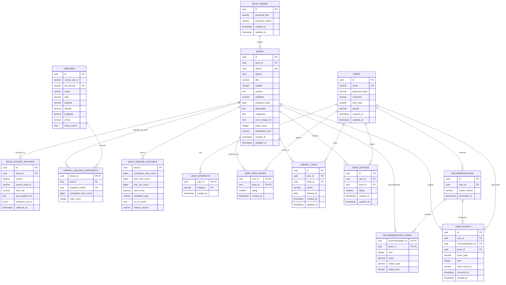

# 백엔드 ERD 초안

> Jira: `S15P21B102-14`
>
> 이 문서는 MVP 백엔드의 PostgreSQL 운영 모델과 추천 배치/분석 모델을 함께 표현한 논리 ERD 초안이다. API의 식별자는 `string` 형태의 opaque ID로 다루며, 실제 DB PK 타입(`uuid` 또는 `bigint`)은 스키마 구현 단계에서 결정한다.

## 1. 설계 원칙

- `books`는 제목이 아니라 **ISBN을 기준으로 한 판본(edition)** 이다. ISBN이 다르면 같은 작품이어도 별도 도서로 저장한다.
- `book_works`는 여러 판본을 묶기 위한 선택적 작품 그룹이다. 제목·저자 유사도만으로 자동 병합하지 않는다.
- `books`에는 서비스가 검색·상세·추천에 실제 사용하는 정제 값만 둔다.
- 카탈로그 L0는 국중과 정보나루의 ISBN13 합집합으로 만들고, 미등재 ISBN은 카카오 온디맨드 등록으로 보강한다. 어떤 출처에서 들어왔는지는 `book_source_records`로 추적한다.
- 도서관별 보유·대출 원장은 대용량 배치/분석 저장소에서 관리하고, 서비스 DB에는 도서관 마스터와 필요한 파생 결과만 둔다.
- 좋아요는 별도 테이블 없이 `library_items.status = WANT_TO_READ`로 처리한다.
- 추천 L1 후보는 누적 대출로 수요 99%를 유지하는 임계와 신간 트랙의 합집합으로 만든다. 누적 대출은 랭킹 주신호로 사용하지 않는다.
- 추천 결과 본문은 `recommendations`, 추천 도서별 순위·점수·이유는 `recommendation_items`로 분리한다.

## 2. 관계도

## 3. 테이블별 최소 칼럼과 제약

### `book_works`

작품 그룹의 표시 정보만 저장한다. 판본 정보는 `books`에 둔다.

| 칼럼 | 타입 | 필수 | 설명 |
| --- | --- | --- | --- |
| `id` | UUID | O | 작품 그룹 식별자 |
| `canonical_title` | VARCHAR | O | 대표 작품명 |
| `canonical_author` | VARCHAR |  | 대표 저자명 |
| `created_at`, `updated_at` | TIMESTAMP | O | 변경 추적 |

### `books`

검색, 상세, 추천에 필요한 정제 도서 정보만 저장한다. `authors`, `categories`는 MVP에서 PostgreSQL 배열 또는 JSONB 중 하나로 구현한다. 추천 후보 여부와 수요 점수는 `book_demand_features`에서 관리하므로 `books`에 중복 저장하지 않는다.

| 칼럼 | 타입 | 필수 | 설명 |
| --- | --- | --- | --- |
| `id` | UUID | O | 내부 도서 식별자 |
| `work_id` | UUID |  | `book_works.id`; 작품 그룹 미확정이면 NULL |
| `isbn13` | CHAR(13) | O | 하이픈 없는 검증된 ISBN-13, UNIQUE |
| `isbn10` | CHAR(10) |  | 보조 ISBN, 마지막 `X` 허용 |
| `title` | VARCHAR | O | 제목 |
| `subtitle` | VARCHAR |  | 부제 |
| `authors` | TEXT[]/JSONB | O | 정제된 저자명 목록 |
| `publisher` | VARCHAR |  | 출판사 |
| `published_date` | DATE |  | 확정된 출간일 |
| `description` | TEXT |  | 책소개·요약 |
| `categories` | TEXT[]/JSONB |  | 카테고리 목록 |
| `cover_image_url` | TEXT |  | 선택된 표지 URL |
| `page_count` | INTEGER |  | 검증된 쪽수 |
| `publication_form` | VARCHAR |  | 종이책·전자책 등 |
| `created_at`, `updated_at` | TIMESTAMP | O | 변경 추적 |

`keywords`, `language`, `quality`, `page_raw`, `series_title`, `volume`, 누적 대출량, 도서관별 보유량은 초기 `books`에서 제외한다. 필요해질 때 별도 마이그레이션 또는 배치 산출물로 추가하고, 출처별 원본 값은 `book_source_records`에서 보존한다.

### `book_source_records`

외부 API별 원본 추적과 정제 실패 확인에 필요한 최소 칼럼이다.

| 칼럼 | 타입 | 필수 | 설명 |
| --- | --- | --- | --- |
| `id` | UUID | O | 원본 레코드 식별자 |
| `book_id` | UUID |  | canonical 도서로 확정되기 전에는 NULL |
| `source` | VARCHAR | O | `NATIONAL_LIBRARY`, `DATA4LIBRARY`, `YES24`, `ALADIN`, `KAKAO` 등 |
| `source_book_id` | VARCHAR |  | 출처별 상품·volume ID |
| `isbn_raw` | VARCHAR |  | 정규화 전 ISBN |
| `raw_payload_ref` | TEXT | O | Git 외부 원본 파일 또는 오브젝트 저장소 참조 |
| `validation_errors` | JSONB |  | 검증 실패 사유 목록 |
| `collected_at` | TIMESTAMP | O | 수집 시각 |

원본 JSON 자체를 DB에 넣는 것은 MVP 범위에서 제외한다. `raw_payload_ref`가 가리키는 원본 보관 정책은 수집 파이프라인에서 정한다.

국중·정보나루 원본에 연결된 레코드는 L0 카탈로그 진입 후보가 된다. 카카오 레코드는 검색 시 ISBN이 L0에 없을 때 온디맨드로 등록할 수 있으며, 모든 경우 ISBN13 정규화와 중복 검사를 먼저 수행한다.

### `libraries`

근처 도서관 조회에 필요한 마스터다. 정보나루 사이트 내부 ID와 API `libCode`는 서로 다를 수 있으므로 둘 다 보존한다.

| 칼럼 | 타입 | 필수 | 설명 |
| --- | --- | --- | --- |
| `id` | UUID | O | 내부 도서관 식별자 |
| `source_site_id` | VARCHAR |  | 사이트 내부 도서관 ID |
| `api_libcode` | VARCHAR | O | 정보나루 API용 도서관 코드, UNIQUE |
| `name` | VARCHAR | O | 도서관명 |
| `type` | VARCHAR |  | 도서관 유형 |
| `address` | VARCHAR |  | 주소 |
| `latitude`, `longitude` | DECIMAL |  | 근처 검색용 좌표 |
| `phone` | VARCHAR |  | 전화번호 |
| `latest_month` | CHAR(7) | O | 최신 보유 스냅샷 월(`YYYY-MM`) |

### `library_holding_snapshots`

121백만 건 규모의 관별 원장이다. PostgreSQL 트랜잭션 테이블이 아니라 Parquet/분석 저장소를 우선 사용하며, 최신 월 데이터만 서비스 조회용으로 materialize할 수 있다.

| 칼럼 | 타입 | 필수 | 설명 |
| --- | --- | --- | --- |
| `library_id` | UUID | O | `libraries.id` |
| `isbn13` | CHAR(13) | O | 하이픈 없는 정규화 ISBN13 |
| `snapshot_month` | CHAR(7) | O | 누적 대출 스냅샷 월 |
| `cumulative_loan_count` | BIGINT | O | 데이터 제공 개시 이후 누적 대출량 |
| `copy_count` | INTEGER | O | 도서관 보유 복본 수 |

기본키는 `(library_id, isbn13, snapshot_month)`다. 최근 2년·3개월 대출량은 두 스냅샷의 차분으로 계산하고, 음수 차분은 0으로 보정한다. 최신 보유 도서 조회 시 `latest_month`의 행을 사용한다.

### `book_demand_features`

배치 작업이 관별 원장에서 월별로 계산한 도서 단위 파생 결과다. 원장 전체를 API 요청마다 재집계하지 않기 위해 별도 산출물로 둔다.

| 칼럼 | 타입 | 필수 | 설명 |
| --- | --- | --- | --- |
| `isbn13` | CHAR(13) | O | `books.isbn13`과 논리적 연결 |
| `cumulative_loan_count` | BIGINT | O | L1 임계·prior용 누적 대출량 |
| `loan_24m_count` | BIGINT | O | 최신과 24개월 전 차분 |
| `loan_3m_count` | BIGINT | O | 최신과 3개월 전 차분 |
| `rank_score` | DECIMAL | O | `loan_24m_count + 4 * loan_3m_count` |
| `candidate_type` | VARCHAR | O | `DEMAND`, `NEW`, `DEMAND_AND_NEW` |
| `as_of_month` | CHAR(7) | O | 산출 기준 월 |
| `feature_version` | VARCHAR | O | 후보·랭킹 산출 버전 |

`library_holding_snapshots`와 `book_demand_features`는 대용량 분석 영역에 둘 수 있으므로 `books`와의 연결은 물리적 FK가 아니라 정규화된 `isbn13` 논리 키로 관리할 수 있다. L1 후보는 `cumulative_loan_count`의 절대값을 고정하지 않고 전체 대출 수요의 99%를 유지하는 임계로 결정한다. 현재 실측값 `72+`는 기준 데이터셋의 결과일 뿐 코드에 영구 상수로 박지 않는다. `NEW`는 국중 2025년 이후 도서 중 도서관 원장에 아직 유입되지 않은 도서로 구성한다.

### `users`

로그인과 콜드스타트 추천 세그먼트에 필요한 정보만 저장한다.

| 칼럼 | 타입 | 필수 | 설명 |
| --- | --- | --- | --- |
| `id` | UUID | O | 사용자 식별자 |
| `email` | VARCHAR | O | 로그인 식별자, UNIQUE |
| `password_hash` | VARCHAR | O | 해시된 비밀번호 |
| `nickname` | VARCHAR |  | 화면 표시명 |
| `birth_year` | SMALLINT |  | 추천 세그먼트 계산용 |
| `gender` | VARCHAR |  | 추천 세그먼트 계산용 |
| `created_at`, `updated_at` | TIMESTAMP | O | 변경 추적 |

### `user_interests`

초기 관심 분야를 저장한다. 별도 카테고리 마스터가 필요하지 않은 MVP이므로 문자열 조합 키를 사용한다.

| 칼럼 | 타입 | 필수 | 설명 |
| --- | --- | --- | --- |
| `user_id` | UUID | O | 사용자 |
| `category` | VARCHAR | O | 관심 분야 |
| `created_at` | TIMESTAMP | O | 등록 시각 |

기본키는 `(user_id, category)`로 하여 같은 관심 분야를 중복 저장하지 않는다.

### `user_seed_books`

초기 취향 설정에서 사용자가 선택·평가한 도서를 저장한다.

| 칼럼 | 타입 | 필수 | 설명 |
| --- | --- | --- | --- |
| `user_id` | UUID | O | 사용자 |
| `book_id` | UUID | O | 선택한 도서 |
| `rating` | SMALLINT | O | 1~5 정수 |
| `created_at` | TIMESTAMP | O | 등록 시각 |

기본키는 `(user_id, book_id)`로 한다. 건너뛰기 여부는 관계 행의 존재 여부로 판단하며, 별도 `skipped` 칼럼은 두지 않는다.

### `library_items`

서재, 좋아요, 독서 상태를 하나의 관계로 관리한다.

| 칼럼 | 타입 | 필수 | 설명 |
| --- | --- | --- | --- |
| `id` | UUID | O | 서재 항목 식별자 |
| `user_id` | UUID | O | 소유 사용자 |
| `book_id` | UUID | O | canonical 도서 |
| `status` | VARCHAR | O | `WANT_TO_READ`, `READING`, `READ` |
| `finished_at` | DATE |  | `READ` 상태의 완독일 |
| `created_at`, `updated_at` | TIMESTAMP | O | 변경 추적 |

`(user_id, book_id)`는 UNIQUE로 한다. `status <> 'READ'`이면 `finished_at IS NULL`이어야 한다.

### `book_ratings`

사용자별 도서 평점을 저장한다. 서재 상태와 분리하므로 서재 등록 없이도 정책상 평점을 허용할 수 있다.

| 칼럼 | 타입 | 필수 | 설명 |
| --- | --- | --- | --- |
| `id` | UUID | O | 평점 식별자 |
| `user_id` | UUID | O | 작성자 |
| `book_id` | UUID | O | 평가 대상 |
| `rating` | SMALLINT | O | 1~5 정수 |
| `created_at`, `updated_at` | TIMESTAMP | O | 변경 추적 |

`(user_id, book_id)`는 UNIQUE로 한다.

### `recommendations`

한 번 계산된 추천 결과 묶음의 메타데이터만 저장한다.

| 칼럼 | 타입 | 필수 | 설명 |
| --- | --- | --- | --- |
| `id` | UUID | O | 추천 결과 식별자 |
| `user_id` | UUID | O | 추천 대상 |
| `model_version` | VARCHAR | O | 계산·폴백 전략 버전 |
| `generated_at` | TIMESTAMP | O | 생성 시각 |

### `recommendation_items`

추천 도서의 순위와 화면 표시용 이유를 저장한다.

| 칼럼 | 타입 | 필수 | 설명 |
| --- | --- | --- | --- |
| `recommendation_id` | UUID | O | 추천 결과 |
| `book_id` | UUID | O | 추천 도서 |
| `rank` | INTEGER | O | 1부터 시작하는 순위 |
| `score` | DECIMAL | O | 추천 점수 |
| `reason_type` | VARCHAR | O | 추천 이유 enum |
| `reason_text` | VARCHAR | O | 화면에 표시할 이유 |

기본키는 `(recommendation_id, book_id)`로 하고, 같은 추천 결과에서 `rank`도 UNIQUE로 한다. 한 도서가 추천 결과 안에서 중복되지 않도록 한다.

### `user_events`

추천 노출·클릭·추천 이유 확인을 측정한다. 이벤트 저장 실패가 핵심 화면을 막지 않도록 별도 흐름으로 처리한다.

| 칼럼 | 타입 | 필수 | 설명 |
| --- | --- | --- | --- |
| `id` | UUID | O | 이벤트 식별자 |
| `user_id` | UUID |  | 비로그인 이벤트 허용 시 NULL |
| `recommendation_id` | UUID |  | 추천 결과 |
| `book_id` | UUID |  | 대상 도서 |
| `event_type` | VARCHAR | O | `IMPRESSION`, `CLICK`, `REASON_VIEW` |
| `rank` | INTEGER |  | 노출 당시 순위 |
| `client_event_id` | VARCHAR |  | 클라이언트 중복 방지 키 |
| `occurred_at` | TIMESTAMP | O | 클라이언트 발생 시각 |
| `created_at` | TIMESTAMP | O | 서버 수신 시각 |

## 4. 제약 및 인덱스 초안

### 필수 제약

- `books.isbn13` UNIQUE, 검증된 13자리 숫자
- `users.email` UNIQUE
- `user_interests` 기본키 `(user_id, category)`
- `user_seed_books` 기본키 `(user_id, book_id)` 및 `rating BETWEEN 1 AND 5`
- `library_items(user_id, book_id)` UNIQUE
- `library_items.status IN ('WANT_TO_READ', 'READING', 'READ')`
- `library_items`의 `READ` 외 상태는 `finished_at IS NULL`
- `book_ratings(user_id, book_id)` UNIQUE 및 `rating BETWEEN 1 AND 5`
- `recommendation_items` 기본키 `(recommendation_id, book_id)` 및 `rank >= 1`
- 추천 결과별 `rank` UNIQUE
- `user_events.event_type` 허용값 제한

### 우선 인덱스

- `books(title)` 또는 검색 엔진 연동을 위한 제목 검색 인덱스
- `books(isbn13)` UNIQUE 인덱스
- `library_holding_snapshots(library_id, isbn13, snapshot_month)` 복합 기본키
- `library_holding_snapshots(isbn13, snapshot_month)`
- `book_demand_features(as_of_month, candidate_type, rank_score DESC)`
- `library_items(user_id, status, updated_at)`
- `book_ratings(book_id)`
- `recommendations(user_id, generated_at DESC)`
- `user_events(recommendation_id, occurred_at)`

## 5. 초기 스키마에서 제외한 것

- 별도 `likes`: `WANT_TO_READ`로 대체
- 별도 `categories`: MVP에서는 관심 분야와 도서 카테고리를 문자열 목록으로 저장
- 도서관별 보유 원장을 PostgreSQL 트랜잭션 테이블로 강제: 대용량 원장은 Parquet/분석 저장소를 우선 사용
- 도서 통계·평균 평점·인기 점수: 조회 시 계산하거나 추천 데이터 파이프라인에서 관리
- 세션·리프레시 토큰: 인증 구현 정책 확정 후 추가
- `raw_payload` 본문: DB가 아니라 외부 원본 저장소에 보관
- 추천 알고리즘 중간 벡터와 상세 feature: 추천 계산 영역의 별도 산출물로 관리

## 6. 구현 시 결정할 사항

- PK를 UUID로 확정할지, BIGINT 내부 키와 opaque API ID를 분리할지 결정
- `authors`, `categories`를 PostgreSQL `TEXT[]`로 저장할지 JSONB로 저장할지 결정
- `book_source_records.raw_payload_ref`의 파일·오브젝트 저장소 규칙 결정
- 사용자 이벤트의 `client_event_id` UNIQUE 범위와 보관 기간 결정
- 추천 결과 보관 기간과 최신 성공 결과 조회 정책 결정
